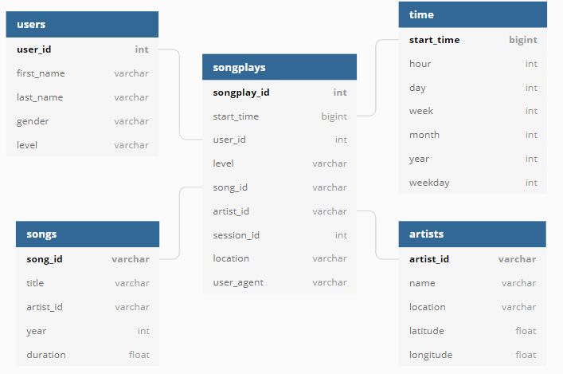

# Postgres ETL: Music Streaming Star Schema

An ETL pipeline that loads raw JSON song metadata and user activity logs from a
fictional music streaming service, **Sparkify**, into a PostgreSQL star schema
optimised for analytics, such as finding the most-played songs, the busiest hours,
or how free and paid users listen.

## Data

| Source | Path | Content |
|---|---|---|
| Song data | `data/song_data/**/*.json` | One song per file with its artist (a subset of the Million Song Dataset) |
| Log data  | `data/log_data/2018/11/*.json` | One file per day of app events (page views, logins, song plays) for November 2018 |

## Schema



A **star schema** keeps analytical queries simple: one fact table that you join
to small, descriptive dimension tables.

| Table | Type | Grain / content |
|---|---|---|
| `songplays` | fact | one row per song played (`page = 'NextSong'`) |
| `users` | dimension | app users; `level` is kept up to date when a user upgrades or downgrades |
| `songs` | dimension | songs in the catalogue |
| `artists` | dimension | artists in the catalogue |
| `time` | dimension | each play timestamp broken down into hour, day, week, month, year, weekday |

Design notes:
- `start_time` is stored as a real `TIMESTAMP` (the raw `ts` is epoch milliseconds).
- `songplays` uses a surrogate `SERIAL` key plus a `UNIQUE (start_time, user_id, session_id)`
  natural key, so re-running the ETL never creates duplicates.
- Foreign keys enforce referential integrity between the fact table and its dimensions.

## Pipeline

```
song_data/*.json ──► artists, songs
                          │  (in-memory lookup: title + artist + duration → ids)
log_data/*.json  ──► time, users, songplays
```

1. **Song files** are read into one DataFrame, de-duplicated and bulk-inserted into
   `artists` and then `songs`.
2. **Log files** are processed one per transaction in date order: filter to `NextSong`
   events, parse timestamps, derive `time` rows, take the latest record per user, and
   resolve each play's `song_id` / `artist_id` against an in-memory lookup.
3. All inserts use `psycopg2.extras.execute_values` (multi-row `INSERT … ON CONFLICT`),
   so the whole dataset loads in a few seconds.

> The song dataset is only a small sample, so only a handful of plays match a catalogue song;
> unmatched plays are still loaded with `NULL` `song_id` / `artist_id`.

## Project structure

| File | Purpose |
|---|---|
| `config.py` | Reads database settings from environment variables / `.env` |
| `sql_queries.py` | All DDL, insert and lookup SQL |
| `create_tables.py` | Drops and recreates the database and tables |
| `etl.py` | The ETL pipeline |
| `etl.ipynb` | Step-by-step exploration of the transformations on sample files |
| `test.ipynb` | Row counts, data-quality checks and example analytics queries |
| `docker-compose.yml` | Local PostgreSQL instance |

## Getting started

```bash
# 1. Install dependencies
python -m venv .venv
source .venv/bin/activate        # Windows: .venv\Scripts\activate
pip install -r requirements.txt

# 2. Configure the connection
cp .env.example .env              # then set DB_PASSWORD etc.

# 3. Start PostgreSQL (or point .env at an existing server)
docker compose up -d

# 4. Build the schema and load the data
python create_tables.py
python etl.py
```

Then open `test.ipynb` to check the load and explore the data.

## Example queries

Busiest hours of the day:

```sql
SELECT t.hour, COUNT(*) AS plays
FROM songplays sp
JOIN time t USING (start_time)
GROUP BY t.hour
ORDER BY plays DESC;
```

Free vs paid listening:

```sql
SELECT level, COUNT(*) AS plays, COUNT(DISTINCT user_id) AS users
FROM songplays
GROUP BY level;
```
